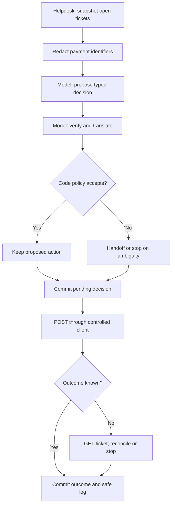

# Design and code walkthrough

This is a small synchronous program, not a collection of autonomous agents.
The application controls the workflow. Hosted language models only return data;
they never receive API credentials or permission to call the helpdesk.

## Read the code in this order

| File | Responsibility |
|---|---|
| `schemas.py` | Typed proposal, internal evidence, reviewer result and API payload |
| `policy.py` | FAQ-only prompts, mandatory escalation, evidence and language checks |
| `helpdesk.py` | Snapshot pagination, handling-state interpretation and submission reconciliation |
| `http.py` | HTTP pacing, bounded retry and transport ambiguity |
| `state.py` | SQLite pending/completed journal, process lock, safe log export |
| `model.py` | Compatible chat API, JSON validation/repair and usage accounting |
| `evaluation.py` | Human-labelled evaluation; labels excluded from model inputs |
| `cli.py` | Small command router and ticket-processing loop |
| `config.py`, `privacy.py` | Environment settings and conservative payment redaction |

The FAQ is the supplied file, bundled with the Python package. There is no external
search, retrieval index, vector database, web server, dashboard, or background worker.
The CLI assumes it is launched from the project folder, where `.env`, `data/`,
`evals/` and `logs/` belong. Python 3.11+ is the only language requirement.

## Flow and trust boundaries

Dry-run exits before the journal/submission steps and prints a private preview.
An unresolved ambiguity stops rather than flowing to a falsely completed outcome.
The diagram's final edge means only a resolved outcome can reach the completed log.

Trusted: application code, supplied FAQ/rules, configured endpoint URLs, human eval
labels. Untrusted: ticket subject/body/plan and model outputs, including a proposed
reply passed to the reviewer. Labels never enter the decision prompt. The model
gets no tools, API keys, shell, URL fetcher or database access.

Prompt injection is not solved by delimiters. System instructions, a separate
review, typed output, FAQ evidence and restricted application actions reduce risk.
Two passes through one model can make correlated mistakes; neither is a proof.

## Deciding what to do

The proposal contains language, category, priority, action, English reason, a reply
or handoff note, confidence, mandatory-handoff flag, FAQ IDs and evidence excerpts.
Only the fields defined in the assignment API are submitted. Internal fields such
as FAQ evidence and action do not leak into the payload schema.

The priority definition comes directly from the brief. The reviewer can escalate
priority, never lower it. Lexical incident/legal-risk rules floor priority at P1;
other mandatory-risk matches floor it at P2. These conservative shortcuts may
over-escalate negated or hypothetical text; improving them requires measured data.

Mandatory handoff applies to refunds/disputes, cancellations/contract changes,
GDPR/AVG requests, possible security incidents, legal threats and threats to leave.
The proposer, reviewer and conservative multilingual lexical rules can each veto a
reply. Do not generalize this to all billing: downloading invoices is answerable.
Likewise, a product feature-request can receive the FAQ's roadmap guidance if it
does not promise a delivery date or trigger a mandatory handoff.

For a reply, every cited FAQ ID must exist and every evidence excerpt must actually
occur in a cited section. The reviewer checks completeness and whether all reply
claims follow from those sections. Exact excerpts alone do NOT establish entailment;
a model could cite a true excerpt while writing an unrelated claim. That is why
there is a separate semantic check. Unverified or low-confidence replies become
handoffs; the 0.8 confidence cutoff is an explicitly uncalibrated extra veto.

Closing requires a separate positive reviewer assessment of spam/empty content.
A complaint, unsupported language or injection attempt is not inherently spam.
Schema failure is repaired once without echoing model output. Repeated invalid
JSON, unknown language or model/reviewer language disagreement stops processing.
This favors visible operational failure over submitting guessed metadata. A stronger
model or manual inspection may be needed before completing all 30 tickets.

## Dutch and human readability

The model works directly in the original language rather than translating first.
This saves an input translation call and preserves Dutch menu labels. A separate
review checks reply language and produces a full English back-translation. Inspect
it in dry-run output or `evals/*.json`, alongside the source FAQ and evidence. The
same mechanism handles English and German. Handoff notes are generated in English
and the reviewer checks that language for an existing handoff.

When code converts an unsafe proposal into a handoff, it creates an English note
from a fixed template and the reviewer's English explanation, asking the human to
read the original helpdesk ticket. This avoids copying sensitive customer text.
Back-translation is generated by the same model and can preserve or conceal errors;
independent bilingual review would be stronger. This limitation is recorded rather
than presenting the check as verified Dutch correctness.

## Failures and crash recovery

| Failure | Behavior |
|---|---|
| 503 | Up to five HTTP attempts with exponential backoff/jitter. The helpdesk contract says nothing was saved. |
| 429 | Wait the server's `Retry-After` (seconds or date); otherwise backoff. No early retry cap is imposed. |
| 400/401/402/404/422 | Stop with status, never dump response/customer data or retry a malformed request. |
| 409 | Never repost the action. GET ticket and confirm handled state. |
| Timeout / transport failure on action | GET ticket first. If handled, finish locally. If explicitly open, allow one resubmission; otherwise stop. |
| Unknown JSON after action success | Treat outcome as ambiguous and reconcile before retrying. |
| Read/model transport failure | Bounded retry. Model requests can be billed more than once after a network ambiguity. |
| Other 5xx | Stop with a pending record; do not assume a write failed before saving. |
| Bad model output | One schema-repair request, then stop without posting. |
| Process crash | OS lock releases; durable pending record survives. Next submitting run reconciles it. |
| Local file/database failure | Stop. Do not guess about remote completion or silently discard pending work. |

The client snapshots all pages before any ticket writes; mutating the open set while
paginating could skip tickets. Duplicate IDs are deduplicated; repeated cursors stop.
Pacing is 0.3 seconds per helpdesk request (below five requests/second) with no worker
concurrency. Model pacing is separately configurable. Provider minute/day token
limits can still be reached even if request pacing is low.

The journal is keyed by endpoint/account scope plus ticket ID. It persists a vetted,
redacted decision and a hash of the relevant ticket fields before the POST. If the
process crashes after the server accepted it, the next run sees the pending ID absent
from the open set, confirms its handled state with GET, and commits the local outcome.
If the ticket remains open and its content hash is unchanged, reuse the same vetted
pending decision instead of generating a different answer. A changed ticket gets a
new decision. Normal completed rows never suppress a newly open remote ticket after
a deliberate reset. `reset --yes` also clears this account's journal after success.

A completed decision is not revalidated against code/prompt changes while it is pending.
Resolve pending submissions before changing policies/model configuration. There is
no distributed lock across computers and no client-only exactly-once guarantee;
the helpdesk's atomic duplicate rejection is essential. Use one account runner.
An explicit remote idempotency key would improve this protocol.

## API response assumptions

The reference gives request fields but does not give full list/detail response shapes.
List parsing expects `{tickets: [...], next_cursor: ...}`. Detail parsing accepts a raw
ticket or `{ticket: ...}` wrapper. Handling-state parsing recognises explicit
`status`, `handled`/`is_handled`, `handled_at`, `decision` or `resolution` metadata.
Missing handling metadata means UNKNOWN, never open. Check a real read-only response
locally with your key before depending on recovery, then add a contract test for its
actual shape. There has been no live contract verification in this delivered build.

During an uncertain POST the client may read 'open' while a slow original request
is still completing. A resubmission must still be protected by the server's atomic
already-handled check. This is why a state check alone does not guarantee exactly once.

Reset is also a remote write. Its transport ambiguity stops without clearing the
journal or automatically repeating a reset. Inspect status and deliberately decide
whether a new reset is needed. Never reset a completed final run accidentally.

## Logging and privacy

One JSONL line per journalled ticket per current practice round is regenerated
atomically from SQLite. It contains only ticket ID, language/category/priority/action,
outcome and timestamp. It contains no free-text reason, reply, payment details or
customer email. A pending line is not a success; check outcome and server status.
Reset starts a new round and clears the current account log.

Common IBANs, long numeric identifiers and labelled CVV/account numbers are redacted
before model requests. Model outputs are redacted again before validation/persistence.
This intentionally may remove non-payment order/phone numbers too. Redaction is
heuristic and cannot guarantee recognition of every creatively formatted payment
detail. Persisted drafts/examples can contain other personal information; they are
ignored by Git and must remain local. API error response bodies are never printed.
Environment secrets are neither in the model context nor in the archive.

## Evaluation and cost

Fetch the ten human-labelled examples once. Preserve them locally and evaluate the
same set before/after. Record accuracy separately for language, category, priority
and action, the number matching all four fields, handoff recall and replies where a
handoff was required. The eval deliberately never sends a ticket decision to the API.
Reply quality is a separate review task, not measured by a matching action label.

`--baseline` omits runtime policy/review checks. It can only run on the evaluation
path. Compare it with guarded results to learn what the safeguards change, then
identify and document an ACTUAL error/fix. The delivered offline refund regression
shows that a forced unsafe model proposal is vetoed; that is not a measured
improvement on Nordavo's real examples. No real before/after scores are supplied.
Use `compare_evals.py`; it refuses comparisons with different dataset hashes.

Usage is appended after each returned model response, including schema-repair
attempts. Reports include model ID, prices, input/output tokens and missing-usage
counts. Unknown usage/prices yield null costs, never fabricated zeros. Counts are
for this invocation; resumed runs can reuse previously paid pending decisions.
Summing private `data/usage.jsonl` gives returned-response usage over all invocations.
Network-ambiguous/provider-side work may incur extra unreported charges: provider
billing remains authoritative. Prices are USD/million tokens; report any required
EUR conversion with its actual rate/date rather than inventing one. Set prices to
zero only for actual free allocation; that does not imply future usage is free.

## Explicit remaining work

The candidate must configure a hosted provider, confirm its availability/quota and
real API shapes, fetch the ten labels, run and inspect the actual eval, make a
measured fix, complete the final 30-ticket run, and fill in README results. The
initial build has offline contract tests, not real Dutch/LLM performance validation.
Keep the README to one page when replacing pending text with measured outcomes.
